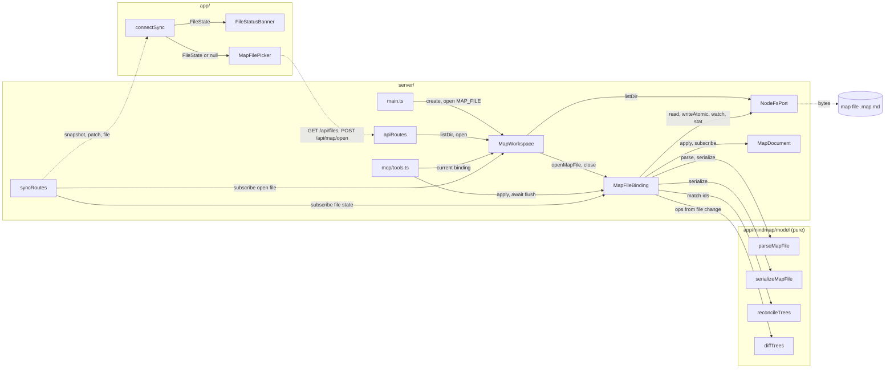
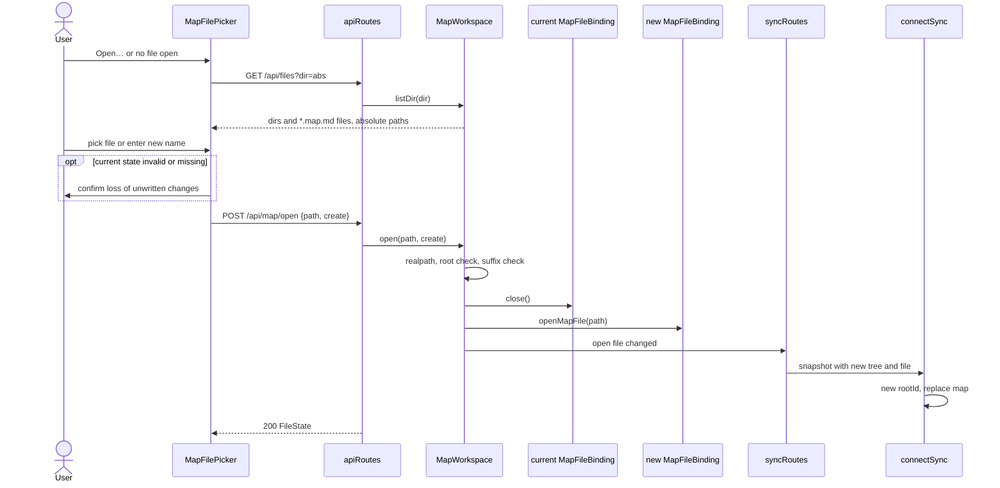
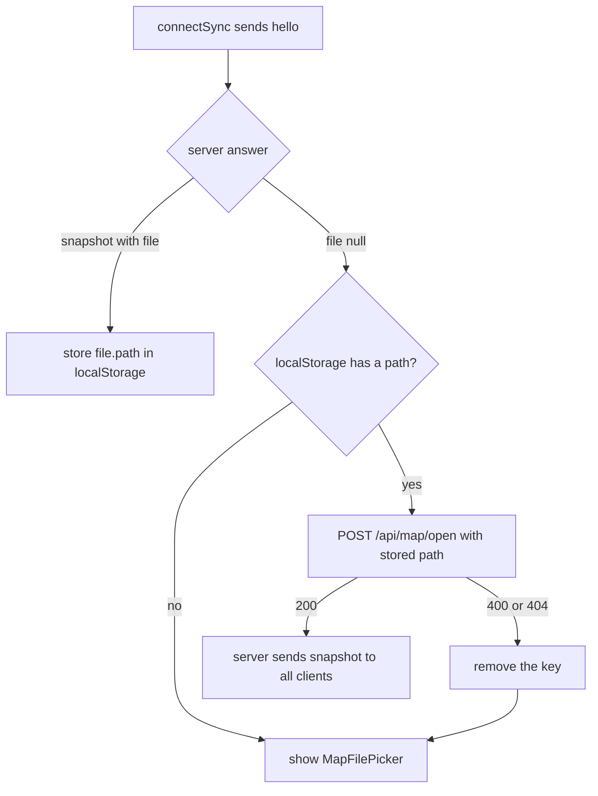
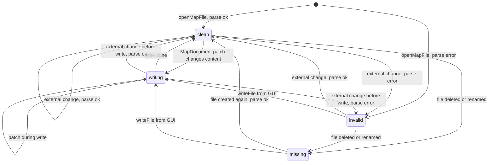
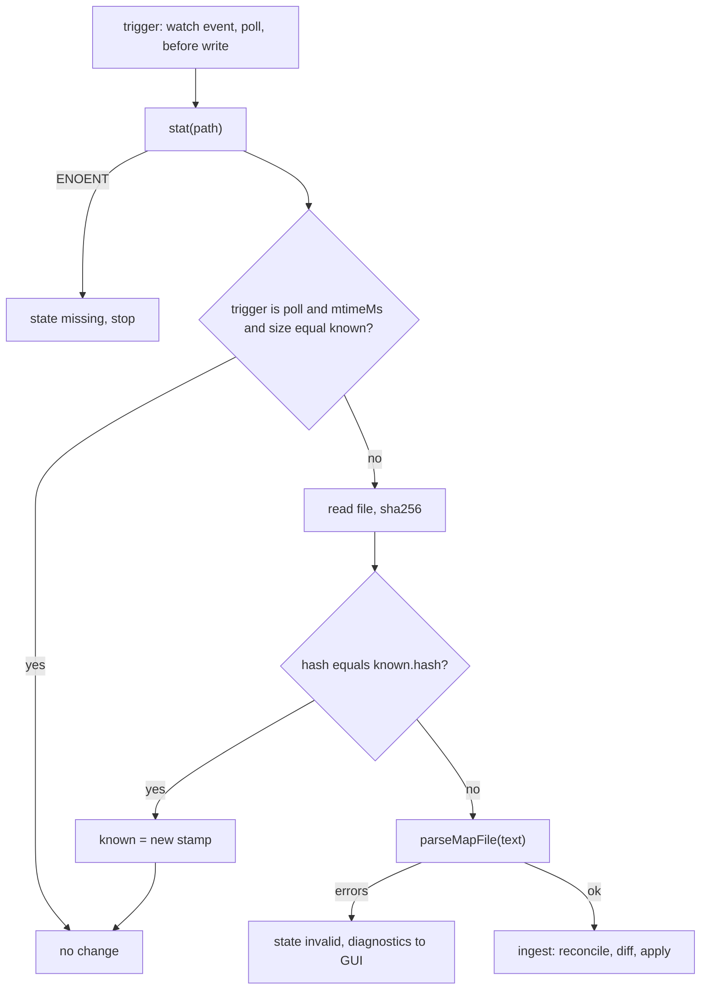
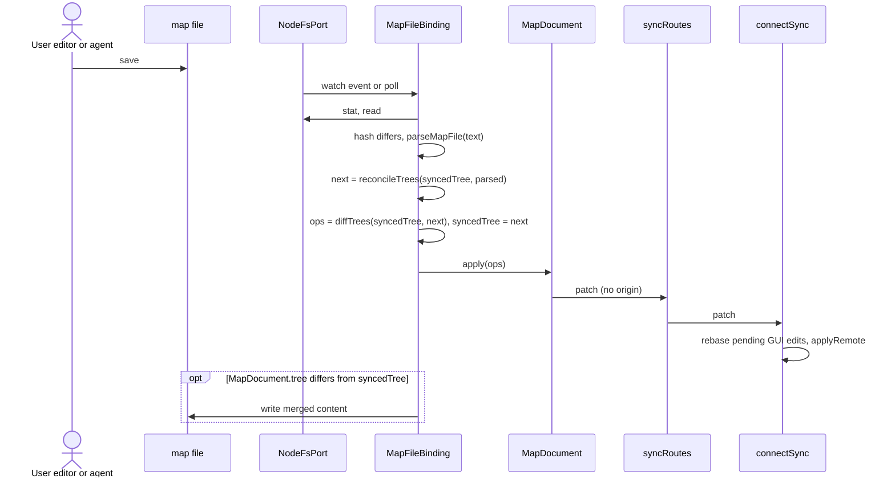
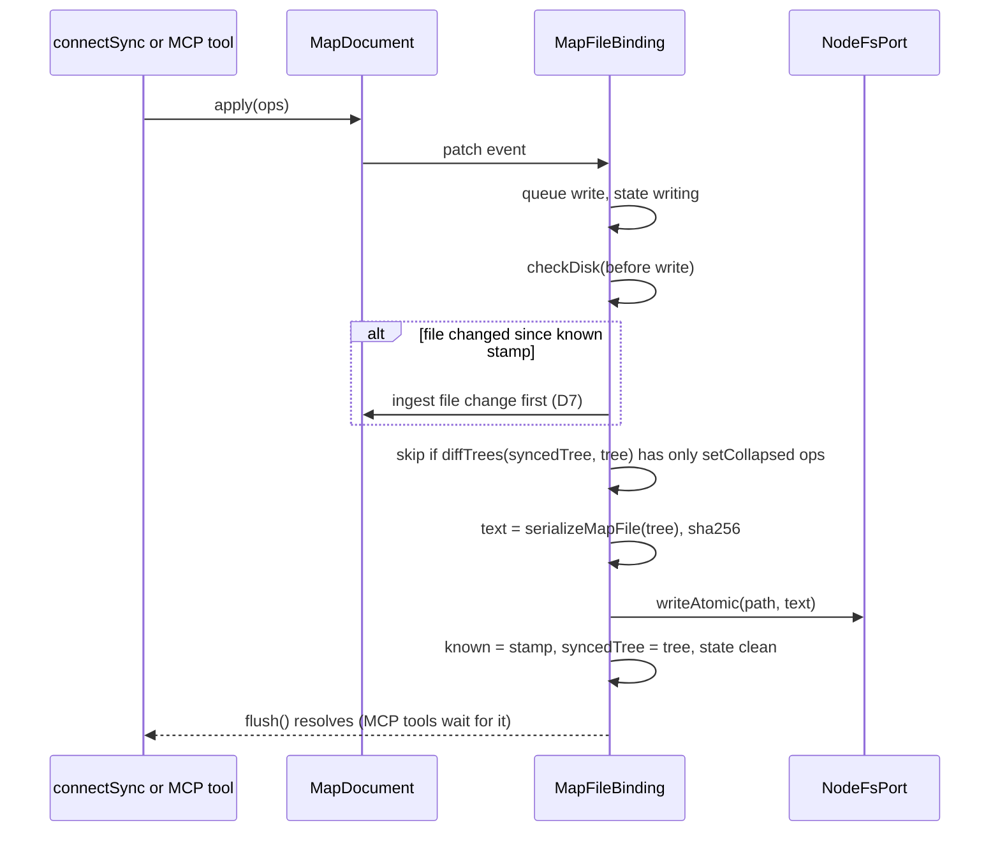

# Map File Lifecycle

## Summary

The server loads the open mind map from a Markdown file and writes every change back to it. It also detects file changes made outside the app.

One user works with the map in three ways:

- **GUI:** edits reach the file through the sync protocol.
- **Text editor:** the user edits the `.map.md` file, and Git versions it.
- **AI agent:** the agent uses MCP tools or edits the file directly.

The `.map.md` file is the durable source of truth, and `MapDocument` is the working copy in memory. Every writer turns into `MapOp` batches, so the GUI receives file changes through the existing `patch` messages.

The user picks the map file in the GUI from a server-side listing of a configured directory. The server opens the picked file by its absolute path, and the GUI never uploads file content (D11).

The app remembers the last file in browser storage and reopens it after a restart.

The main design decision is change detection by file stamp (modification time, size), confirmed by a content hash (D5).

## Context and Gap

| Existing | State today | Change |
| --- | --- | --- |
| [mapDocument.ts](../server/map/mapDocument.ts) | Holds one map in memory. A restart resets it to `Central Topic`. | Unchanged role. A new `MapFileBinding` loads it from the file and writes it back. |
| [markdown.ts](../app/mindmap/model/markdown.ts) | Line parser for a bare Markdown list. A `#` heading becomes a top-level item. Used by `add_topics` and `replace_map`. | Stays for the MCP `markdown` argument. A new section-aware parser reads whole `.map.md` files (D9). |
| [software-quality.map.md](examples/software-quality.map.md) | Frontmatter `mindmap: true`, a `# Map` list, then `---` and a `# <Topic>` note section. | Rewritten in format v1 (D2). |
| [types.ts](../app/mindmap/model/types.ts) `MindNode` | `id`, `text`, `parentId`, `children`, `collapsed`. No note. | Gets `note?: string`. |
| [ops.ts](../app/mindmap/model/ops.ts) `MapOp` | `add`, `remove`, `move`, `setText`, `setCollapsed`. `diffTrees` ignores notes. | Gets `setNote`. `diffTrees` emits `setNote`. |
| [tree.ts](../app/mindmap/model/tree.ts) `fromOutline` | Creates path ids (`root`, `root.0`). Every map gets the root id `root`. | The file loader assigns random ids (D3). |
| [topicRef.ts](../server/mcp/topicRef.ts) | Name and path resolution for agents, including `normalize()`. Lives in `server/mcp`. | The pure matching part moves to `app/mindmap/model/topicPath.ts`, so the parser can resolve note headings. |
| [protocol.ts](../app/mindmap/sync/protocol.ts) | `snapshot`, `patch`, `focus`, `error`. No file state. | `snapshot` gets `file`. New messages: `file` (server to app), `writeFile` (app to server). |
| [main.ts](../server/main.ts) | Starts the server with an empty map. | Creates a `MapWorkspace` for `MAPS_DIR`, and opens `MAP_FILE` if it is set (D11). |
| [app.ts](../server/app.ts) `buildServer()` | Takes one `MapDocument` and passes it to all routes. | Takes a `MapWorkspace`. Routes get the current binding from it on each request. |
| [api/routing.ts](../server/api/routing.ts) | Read-only `GET /api/health` and `GET /api/map`. | New `GET /api/files` and `POST /api/map/open` (D11). |
| [Toolbar.tsx](../app/mindmap/components/Toolbar.tsx) | No file actions. | Gets an "Open…" button and shows the absolute path of the open file. |
| [jest.config.cjs](../jest.config.cjs) | Jest with `ts-jest` in CommonJS mode runs `*.test.ts`. `@storybook/test-runner` (Jest-based) runs the story play tests. | Removed. Vitest runs both (D12). |
| [mcp-server-spec.md](mcp-server-spec.md) | Lists persistence as out of scope. | Updated in Phase X. |

## Design Decisions

### D1: The file is the durable truth, and `MapDocument` is the working copy

- **Decision:** `MapFileBinding` connects one `.map.md` file to one `MapDocument`. GUI edits, MCP tool calls and file changes all become `MapOp` batches applied by `MapDocument.apply()`. The binding writes the document to the file after each change.
- **Reason:** the sync protocol already pushes every `MapDocument` change to the GUI, rebases unconfirmed GUI edits, and keeps undo per author. A file change that becomes ops reuses all of this, and the GUI needs no file-specific code path for content. The file must stay the truth because the user reviews and versions it in Git, and agents read it without the server.
- **Rejected:** the GUI reads and writes the file itself (through Tauri `fs`). The MCP server and the GUI would then be two writers of the same file with no common state, and every agent change would need a file round trip.
- **Rejected:** the file is only an export, and an app database holds the truth. Git review is the main reason for the Markdown format, so the file must be the truth.

### D2: Format v1 has a `# Map` list section and a `# Notes` section with one `##` heading per topic

- **Decision:** the file format is the one in [File format v1](#file-format-v1). Notes use `## <topic reference>` headings under `# Notes`. The format has no `---` separators outside the frontmatter.
- **Reason:** the outline stays short and easy to scan in a diff, and long notes do not split it. A line of text directly above `---` is a setext H2 heading in CommonMark, so the `---` separator of the current example turns the last note line into a heading in every Markdown viewer. A fixed `# Notes` section also tells the parser where notes start without a guess.
- **Rejected:** notes as indented paragraphs inside list items. This keeps each note next to its topic, but a 20-line note hides the tree structure in the diff and in the editor.
- **Rejected:** one `# <Topic>` H1 per note (current example). An H1 per note cannot be told apart from a user section such as `# References`.

### D3: The file contains no topic ids, and the server matches topics after a file change

- **Decision:** topic ids exist only in memory. The loader assigns random ids (`newId()`), including the root. After a file change, `reconcileTrees()` maps the new parse onto the previous tree to keep ids of unchanged, renamed and moved topics.
- **Reason:** ids in the file add noise to every diff, and humans and agents edit the file by topic text. The ids are needed only for GUI continuity (selection, undo history, pending edits). The file content always defines the result, so a weak match costs only UX, never data. A random root id per load makes `connectSync` replace the map after a server restart (it compares `rootId`), so pending GUI ops with stale ids cannot hit a different topic.
- **Rejected:** an id after the topic text, as an HTML comment or an Obsidian-style block anchor (`- Topic ^n1a2`). Both are stable, but they show in every diff and agents copy or break them.
- **Rejected:** path ids from `fromOutline()` (`root.0.1`). After an offline edit of the file, the same id names a different topic, and a pending GUI op then changes the wrong topic.

### D4: The folded state (`collapsed`) is not stored in the file

- **Decision:** the serializer ignores `collapsed`. `MapFileBinding` does not write the file after a batch that changes only `collapsed`. Folded state lives in memory only.
- **Reason:** folding a branch is a view action. If the file stored it, each fold would create a Git change with no meaning.
- **Rejected:** a collapsed marker (an HTML comment) after the bullet text. It produces diff noise for a view change.
- **Rejected:** a gitignored sidecar file `.thinking-patterns/view.json` keyed by topic path. Folds would survive a restart, but the second file needs its own path matching after renames. The user confirmed memory only.
- **Revisit if:** the user wants folded state to survive restarts. The sidecar can come later without a format change.

> Clarification: a restart and the opening of another file unfold all topics. The user accepted this trade-off.

### D5: The binding detects file changes by stamp and confirms them by content hash

- **Decision:** `FileStamp` is `{mtimeMs, size, hash}` of the file as last read or written. Three triggers run `checkDisk()`: a directory watch event, a 1000 ms poll, and the start of every write. The poll compares `mtimeMs` and `size` first, and reads the file only if one of them changed. A watch event always reads the file. A read file counts as changed only if its SHA-256 hash differs from `known.hash`.
- **Reason:** the user asked to track the file update time, and `stat()` is cheap enough to poll. The modification time alone is not reliable. `git checkout` and some editors change it without a content change, and some file systems store it with 1 s or 2 s resolution, so two writes in the same second can have the same time. The hash removes false changes and suppresses the echo of the binding's own writes. The poll catches events that `fs.watch` misses.
- **Rejected:** modification time only. It misses same-second, same-size edits and reports false changes.
- **Rejected:** the `chokidar` package. It adds a dependency, and the poll already covers the missed events of `fs.watch`. The Rust port uses the `notify` crate with the same poll.

> Assumption: `fs.watch` on a macOS directory reports the rename that an atomic save (ours or an editor's) causes. If it does not, the 1000 ms poll still detects the change. Verify in the `MapFileBinding` integration test with the real file system.

> Clarification: verified. The integration test in `server/map/__tests__/mapFileBinding.test.ts` turns the poll off and detects an atomic rename save on macOS through `fs.watch`.

### D6: The binding writes through after each change, with coalescing and atomic replace

- **Decision:** after each `MapDocument` patch, the binding starts a write if none is running. Changes during a running write cause one more write after it. A write goes to a temp file in the same directory, then `rename()` replaces the target. MCP change tools wait until the write of their batch completes before they return.
- **Reason:** GUI edits arrive per committed action, not per keystroke, so a debounce timer adds delay with no gain. A short time between change and write keeps the window for conflicts with the text editor small. The agent can read the file right after an MCP call and see its change. The atomic replace prevents a half-written file that the editor or Git could read.
- **Rejected:** a debounced write (for example 400 ms). It keeps unwritten changes in memory longer, and the MCP response would arrive before the file changes.

### D7: A file change wins, and unwritten in-memory changes are rebased on it

- **Decision:** on a file change, the binding computes ops from `syncedTree` (the tree as last read from or written to the file) to the reconciled new parse, and applies them to `MapDocument` as one batch. Changes that exist only in memory stay, because `MapOp`s apply leniently. If `MapDocument.tree` then differs from the new `syncedTree`, the binding writes the file.
- **Reason:** there is one user. A conflict happens only when the user edits the file and the GUI within the same write window, or when an agent edits the file during a GUI edit. The rebase keeps both changes in almost all cases, and the same rule already runs in `connectSync`. A conflict dialog for one user would ask the user to choose between two of their own edits.
- **Rejected:** a text-level three-way merge. The map is a tree, and the tree-level rebase already exists.
- **Rejected:** a conflict dialog in the GUI. See the reason above.

### D8: The server never writes the file only to change its formatting

- **Decision:** after the binding applies a file change, it writes the file only if the tree content differs from the parsed file. The binding never rewrites a hand-edited file only to normalize it (for example `*` bullets or 4-space indentation).
- **Reason:** a rewrite that the user did not cause shows up as a Git change and can overwrite an open editor buffer.

### D9: `remark-parse` reads the file, and a project serializer writes it

- **Decision:** `parseMapFile()` builds an mdast tree with `remark-parse` and `remark-frontmatter`. It copies the text of each topic and each note from the file by the node `position` offsets. `serializeMapFile()` is project code that writes the canonical file from `MapFileModel`. Golden fixtures in `app/mindmap/model/mapFile/fixtures/` define the expected parse of each sample file.
- **Reason:** the user reviews the file on GitHub and in Git diffs, so the app MUST read the file with the same CommonMark rules that render it there. Examples are lazy continuation lines, `~~~` fences, indented code in notes and list item interruption. A line scanner gets these cases wrong, and each difference shows the reviewer a different map than the app loads. Each mdast node has `position.start.offset` and `position.end.offset`. The parser therefore copies topic and note text byte for byte, and inline Markdown and escapes stay as the user wrote them.
- **Reason (serializer):** the file is written from the in-memory tree, not from an mdast tree. The output is only a list, headings and verbatim note text, so a small serializer gives full control of the canonical form. `remark-stringify` applies its own formatting choices to bullets, escapes and blank lines.
- **Reason (Rust):** the Rust back end uses a CommonMark parser that reports source offsets (`pulldown-cmark` or `comrak`). Both implementations follow the same specification, and the shared fixtures detect differences.
- **Rejected:** a hand-written line scanner. It has no dependencies, but it is a private Markdown dialect, and it would be written twice (TypeScript and Rust) with no specification to test against. An earlier draft chose it because of a Jest setup problem. That problem belongs to the test runner, and D12 removes it.
- **Rejected:** `@tanstack/markdown` 1.2.1 (`parseMarkdown` from `@tanstack/markdown/parser`). It is small, has no runtime dependencies, and reads frontmatter. It cannot keep the file intact for three reasons:
  - Its AST has no source positions, so the parser cannot copy the original text of a topic or a note.
  - It resolves inline Markdown and escapes. For example, `\-` becomes `-` and `**Factory**` becomes a `strong` node.
  - It has no Markdown serializer, only HTML and React renderers.

  Every write would then change topic and note text that the user did not edit.

- **Rejected:** `remark-gfm`. The parser copies topic and note text verbatim and does not interpret inline syntax, so GFM extensions (tables, task lists, strikethrough) do not change the map structure.

> Source: test parse with `@tanstack/markdown@1.2.1`, and `dist/types.d.ts` of that version (no `position` field on any node). Project page: https://tanstack.com/markdown/latest

> Assumption: `remark-parse` 11.0.0 (part of remark 15) and `remark-frontmatter` 5 are the current majors, and both are ESM-only. Verify with `npm view remark-parse version` and `npm view remark-frontmatter version` before the install.

> Clarification: verified. `npm view` returned `remark-parse` 11.0.0 and `remark-frontmatter` 5.0.0. The parser also needs `unified` 11 (runtime) and `@types/mdast` (types only).

> Clarification: CommonMark parses Git conflict markers (`<<<<<<<`, `=======`, `>>>>>>>`) as paragraph text or as a setext heading underline. `parseMapFile()` therefore checks the raw lines for these markers before it calls `remark-parse`.

### D10: Writes pause while the file is invalid or missing

- **Decision:** in the `invalid` and `missing` states, the binding does not write. GUI edits still apply in memory. MCP change tools return an error with the diagnostics. The GUI shows a banner with a "Write the app version to the file" action, which sends `writeFile`.
- **Reason:** an invalid file is often an edit in progress or a Git merge conflict (`<<<<<<<`), and a write would destroy the user's work. A missing file is often a `git checkout` of a branch without it, and a write would add an untracked file to that branch. The agent gets an error because it can fix the file itself. A GUI user sees the banner and decides.

### D11: The user picks the map file in the GUI from a server-side directory listing

- **Decision:** `MapWorkspace` holds the maps root directory (`MAPS_DIR`, default: the server working directory) and at most one open `MapFileBinding`. The GUI file picker browses the root with `GET /api/files`. The user picks a file, and the GUI sends its absolute path to `POST /api/map/open`. The server opens the file in place with `openMapFile()`. The GUI never sends file content.
- **Decision:** the server starts with no open file. If `MAP_FILE` is set, the server opens that file before `listen()`. There is no default file name.
- **Decision:** the picker lists subdirectories and `*.map.md` files. It hides directories that start with `.` and `node_modules`.
- **Decision:** the picker can create a new map: `POST /api/map/open` with `create: true` creates `<dir>/<name>.map.md` with format v1 and the root topic `Central Topic`. The request fails if the file exists.
- **Decision:** the app remembers the last opened file in browser `localStorage` (key `thinking-patterns.lastMapFile`, value: the absolute path). After `hello`, if the server answers with `file: null`, the app sends the stored path to `POST /api/map/open`. On a 400 or 404 response, the app removes the key and shows the picker. If the server already has a file open (`MAP_FILE` or another window), the app does not send the stored path.
- **Decision:** one file is open at a time. Opening another file closes the current binding first (`close()` flushes it), then opens the new file with a new `MapDocument`. All connected clients get a `snapshot` of the new map.
- **Reason:** the user asked for a file picker that uses the file by its fully qualified name, not an upload. The file must stay where it is, because the user edits it in a text editor and versions it with Git, and agents edit it with file tools (D1). An uploaded copy would break all three. The server reads the directory, because a browser page cannot read absolute paths from the local disk.
- **Reason (no default):** a default such as `./map.md` creates a file in the repository root on the first start. With the picker, the user chooses or creates the file.
- **Reason (reopen):** the user asked to reopen the last file after a restart, and to keep it in browser storage. The server then keeps no state file, which matches the memory-only choice for folded state (D4).
- **Reason (`*.map.md` only):** the suffix marks a mind map file. A list of every `.md` file shows READMEs and docs that are not maps and fail to parse.
- **Reason (one file):** the MCP spec defines one open map, and a single user works on one map at a time.
- **Rejected:** upload of the file content from a browser `<input type="file">`. The browser gives no absolute path, so the server cannot write the change back to the original file.
- **Rejected:** a free-text path field with no listing. The user must type or paste a long path, and a typing error opens nothing.
- **Rejected:** a gitignored server state file (`.thinking-patterns/state.json` under `MAPS_DIR`) for the last path. It works for every browser, but it adds a second file to the repository directory and a stale path to handle on the server.
- **Rejected:** server refuses to start without `MAP_FILE`. `npm run dev:all` then needs an extra setting, and the user cannot switch maps.

> Rationale (root check): `POST /api/map/open` and `GET /api/files` accept only paths inside `MAPS_DIR`, after `realpath()`. The server listens on `127.0.0.1`, but a web page in the user's browser can still send requests to it. The root check stops such a request from reading or creating files elsewhere on the disk. `MAP_FILE` is trusted configuration and has no root check.

> Rationale (switch): `close()` flushes the current binding, so the switch writes all pending changes of a `clean` or `writing` file. In the `invalid` and `missing` states, `close()` cannot write and drops the in-memory changes. The picker therefore asks the user to confirm the switch in these two states.

> Context: the random root id of each load (D3) makes `connectSync` replace the map on the new `snapshot`. Pending GUI ops of the previous map then skip, because their ids do not exist in the new map.

> Rationale (no override): a running server with an open file is the current state of the user's work. A stored path from an older session MUST NOT switch it, because a second window or a restarted tab would then close the file the user works on.

> Assumption: Tauri webviews keep `localStorage` between app starts (WKWebView on macOS, WebView2 on Windows). Verify in the Tauri port. If it does not persist, use the Tauri `store` plugin with the same key.

> Clarification: the Tauri app MAY replace the picker with a native file dialog later. It sends the picked absolute path to the same open endpoint.

### D12: Vitest replaces Jest for all tests

- **Decision:** Vitest runs the unit and server tests (`*.test.ts`) and the Storybook play tests (`@storybook/addon-vitest`). The project removes `jest`, `ts-jest`, `@types/jest`, `@storybook/test-runner` and `jest.config.cjs`. Playwright stays for E2E.
- **Reason:** `ts-jest` runs in CommonJS mode, and Jest has its own module loader. ESM-only packages such as `remark-parse` then need an experimental Jest ESM setup (`--experimental-vm-modules`). Vitest uses the Vite pipeline that the app already builds with (Vite 8), so ESM packages, TypeScript and the `tsconfig.json` settings work with no extra transform setup. One test runner for unit and Storybook tests removes the second Jest that `@storybook/test-runner` brings.
- **Rejected:** ts-jest in ESM mode (`extensionsToTreatAsEsm`, `NODE_OPTIONS=--experimental-vm-modules`). It keeps Jest, but it depends on an experimental Node flag and keeps a second transform setup next to Vite.

> Context: the tests use only `describe`, `it`, `expect` and lifecycle hooks. No test calls `jest.fn`, `jest.spyOn`, `jest.mock` or `jest.useFakeTimers` (checked with `grep -rn "jest\." app server`). The migration replaces the Jest globals with Vitest imports or with `test.globals: true`.

> Assumption: `@storybook/addon-vitest` 10.6.8 matches Storybook 10.6.8 and accepts `vitest` 4 or 5 with `@vitest/browser-playwright` (from its `peerDependencies`). The addon runs stories in a real browser through Playwright, which the project already installs. Verify that `npx storybook add @storybook/addon-vitest` produces a working `vitest.config.ts` project for the stories.

## Technical Breakdown

### File format v1

```md
---
mindmap: 1
---

# Map

- Software Factory
  - Loops
    - Forward Pressure
    - Backward pressure
  - Software Quality Attributes
    - Performance
      - k6

# Notes

## Software Factory

The description of software factory. Notes can contain any Markdown, including `###` headings and fenced code.

## Software Quality Attributes > Performance

Measured with k6 in the nightly pipeline.
```

| Element | Rule | Parse result if broken |
| --- | --- | --- |
| Frontmatter | MUST be the first block and MUST contain `mindmap: 1`. Other keys are kept verbatim. | Error |
| `# Map` | MUST exist once and MUST hold exactly one top-level bullet: the central topic. | Error |
| List | Bullets `-`, `*`, `+`, `1.`. Any consistent indentation. Indented non-bullet lines continue the topic text. | Error for text that is not in a list item |
| Topic text | Inline Markdown is kept verbatim. The serializer escapes a leading `-`, `*`, `+`, `#` or `1.` with `\`. | - |
| `# Notes` | Optional. Each `## <heading>` starts the note of one topic. The note ends at the next `#` or `##` heading outside a code fence. | - |
| Note heading | Topic text, or the shortest unique trailing path joined with `>`. Matching uses the `topicPath` rules (case and whitespace do not matter). | Warning: the note is an orphan |
| Other `#` sections | Kept verbatim, written after `# Notes`. | - |
| `<<<<<<<`, `=======`, `>>>>>>>` lines | Git conflict markers. | Error |

- The serializer writes LF line endings, a final newline, `-` bullets, and 2 spaces per level.
- The serializer writes notes in pre-order of the tree, then orphan notes in their original order.
- The serializer writes the frontmatter verbatim. A new file gets `mindmap: 1`.
- An orphan note stays in the file and in `FileState.diagnostics`. The user fixes its heading.
- A topic rename in the GUI or through MCP rewrites its note heading, so the note follows the topic.

> Rationale: notes refer to topics by the same name and path rules as the MCP tools ([topicRef.ts](../server/mcp/topicRef.ts)), so the user and agents have one way to name a topic. A note heading uses a path only when the topic text is not unique, which keeps headings short in the common case.

### Components

The binding sits between the file system and the existing `MapDocument`. The pure format code is in `app/mindmap/model/mapFile/`.



- `MapFileBinding` is the only module that writes the map file. `MapWorkspace` creates a new file only through `openMapFile()`.
- `NodeFsPort` is the only module that imports `node:fs`. Tests use `MemoryFsPort`.
- Routes and MCP tools get the current binding from `MapWorkspace` on each request. They keep no reference across a file switch.
- The Tauri back end replaces `MapWorkspace`, `MapFileBinding` and `NodeFsPort` with Rust code and keeps the protocol and the REST endpoints.

### The user picks and opens a map file



| Request | Error | Status |
| --- | --- | --- |
| `GET /api/files` | `dir` is outside `MAPS_DIR` or is not a directory | 400 |
| `POST /api/map/open` | `path` is not absolute, is outside `MAPS_DIR`, or does not end with `.map.md` | 400 |
| `POST /api/map/open` | File does not exist and `create` is not `true` | 404 |
| `POST /api/map/open` | `create` is `true` and the file exists | 409 |
| `POST /api/map/open` | File parses with errors | 200, binding in state `invalid` |

- An `invalid` file opens like in D10: the GUI shows the banner and the user fixes the file.
- A request that opens the file that is already open returns its `FileState` and changes nothing.
- After each successful open, the app writes the path to `localStorage` (D11).

The app reopens the last file after a server restart:



- `MapWorkspace` runs one `open()` at a time (a promise queue).

### File state lifecycle

`FileState.state` holds the values below. The GUI shows each state.



| State     | Writes | GUI                                                             | MCP change tools        |
| --------- | ------ | --------------------------------------------------------------- | ----------------------- |
| `clean`   | Run    | Status "Saved"                                                  | Run                     |
| `writing` | Run    | Status "Saving…"                                                | Run, wait for the write |
| `invalid` | Paused | Banner with diagnostics and "Write the app version to the file" | Error with diagnostics  |
| `missing` | Paused | Banner "File not found" and "Write the app version to the file" | Error                   |

> Rationale: an external change in the `invalid` state that parses again is ingested with the same rebase as in `clean` (D7). GUI edits made while the file was invalid are then kept, with no special case.

### Change detection

`checkDisk(trigger)` runs for every trigger. Only one `checkDisk()` or write runs at a time (a promise queue in the binding).



### A file change reaches the GUI

This flow serves a user edit in an editor, an agent edit with a file tool, and `git checkout`.



- The GUI shows the file change like an agent change: no undo step, and the user's own undo history stays.
- Only when unwritten in-memory changes existed does the merged content differ from the file, so the binding writes (D8).

### A GUI or MCP change reaches the file



> Risk: a user editor save that lands between `checkDisk(before write)` and `rename()` is overwritten. The window is a few milliseconds and needs a save in the same moment as a GUI or agent change, by the single user. Fallback: the binding runs `stat()` again just before `rename()` and runs `checkDisk()` again if the stamp changed. The overwritten text stays in the editor buffer, and Git keeps the committed version.

### Id reconciliation

`reconcileTrees(previous, parsed)` returns `parsed` with ids from `previous` where topics match. It runs in this order:

| Step | Match rule | Resulting op in `diffTrees` |
| --- | --- | --- |
| 1 | Root to root, always. | `setText` if the root text changed |
| 2 | Children of matched parents: equal normalized text, in order (longest common subsequence). | None, or `move` for a new index |
| 3 | Remaining children of matched parents, if the old and new remaining counts are equal: by position. | `setText` (rename in place) |
| 4 | Remaining new topics in the whole tree: equal normalized text with a remaining old topic, if that text is unique among the remaining topics. | `move` |
| 5 | Remaining new topics get `newId()`. Remaining old topics are removed. | `add`, `remove` |

- Steps 2 to 4 run top-down, so the children of a matched topic are matched in the next level.
- Notes and text come from `parsed`. `collapsed` comes from `previous` for matched topics.

> Rationale: the steps cover the common edits of a person or an agent: rename, reorder, move, add and delete. A wrong match changes only which topic keeps the selection and the undo history. The resulting tree content always equals the file (see D3).

### Planned APIs

```typescript
// app/mindmap/model/mapFile/types.ts
interface MapFileModel {
  tree: MindMapTree; // topics with notes; ids are random (newId)
  frontmatter: string; // frontmatter lines between the --- markers, verbatim
  extraSections: string; // other # sections, verbatim, in file order
  orphanNotes: {heading: string; body: string}[]; // notes whose heading matches no topic
}

interface Diagnostic {
  line: number; // 1-based line in the file
  severity: 'error' | 'warning'; // an error makes the file invalid
  message: string; // shown to the user and to agents as is
}

type ParseResult = {ok: true; model: MapFileModel; diagnostics: Diagnostic[]} | {ok: false; diagnostics: Diagnostic[]};

// app/mindmap/model/mapFile/parse.ts, serialize.ts, reconcile.ts
declare function parseMapFile(text: string): ParseResult; // pure, never throws
declare function serializeMapFile(model: MapFileModel): string; // canonical, deterministic
declare function reconcileTrees(previous: MindMapTree, parsed: MindMapTree): MindMapTree; // ids from previous where matched

// server/map/fsPort.ts
interface FsPort {
  stat(path: string): Promise<{mtimeMs: number; size: number} | null>; // null if the file does not exist
  read(path: string): Promise<string>; // UTF-8
  writeAtomic(path: string, text: string): Promise<void>; // temp file in the same directory, then rename
  watchDir(dir: string, onChange: (fileName: string) => void): () => void; // returns unsubscribe
  listDir(dir: string): Promise<{name: string; kind: 'dir' | 'file'}[]>; // direct entries only
  realpath(path: string): Promise<string>; // resolves symlinks; rejects if the path does not exist
}

// server/map/mapFileBinding.ts
interface FileStamp {
  mtimeMs: number; // from stat()
  size: number; // bytes
  hash: string; // sha256 hex of the content
}

type FileStateKind = 'clean' | 'writing' | 'invalid' | 'missing';

interface FileState {
  path: string; // absolute path of the map file
  state: FileStateKind; // see the File state lifecycle
  diagnostics: Diagnostic[]; // errors and warnings of the last parse
  writtenAt: string | null; // ISO time of the last write by the binding
  changedOnDiskAt: string | null; // ISO time of the last external change the binding ingested
}

interface MapFileBinding {
  readonly doc: MapDocument; // the working copy
  fileState(): FileState; // current state for snapshots and get_map_info
  subscribe(listener: (state: FileState) => void): () => void; // file state changes for syncRoutes
  flush(): Promise<void>; // resolves when all changes so far are written, rejects in invalid or missing
  forceWrite(): Promise<void>; // writes the in-memory map in any state (GUI writeFile)
  close(): Promise<void>; // flushes, stops watch and poll
}

declare function openMapFile(
  path: string,
  opts?: {fs?: FsPort; pollMs?: number; create?: boolean},
): Promise<MapFileBinding>; // create: write a new format v1 file, reject if it exists

// server/map/mapWorkspace.ts
interface DirListing {
  root: string; // absolute path of MAPS_DIR
  dir: string; // absolute path of the listed directory
  parent: string | null; // absolute path of the parent directory, null at the root
  entries: {name: string; path: string; kind: 'dir' | 'file'}[]; // subdirectories first, then *.map.md files, each sorted by name
}

interface MapWorkspace {
  readonly root: string; // absolute path of MAPS_DIR
  current(): MapFileBinding | null; // the open file, null before the first open
  listDir(dir?: string): Promise<DirListing>; // default: root; rejects outside root
  open(path: string, opts?: {create?: boolean}): Promise<FileState>; // closes the current binding, opens path
  subscribe(listener: (binding: MapFileBinding | null) => void): () => void; // open file changes for syncRoutes
  close(): Promise<void>; // closes the current binding
}

declare function createMapWorkspace(root: string, opts?: {fs?: FsPort; pollMs?: number}): MapWorkspace;

// app/mindmap/sync/lastMapFile.ts
declare function loadLastMapFile(): string | null; // null if not stored or storage throws
declare function saveLastMapFile(path: string): void; // ignores storage errors
declare function clearLastMapFile(): void; // ignores storage errors

// app/mindmap/components/MapFilePicker.tsx
interface MapFilePickerProps {
  currentFile: FileState | null; // null: no file open, the picker cannot be dismissed
  onOpened(file: FileState): void; // called after POST /api/map/open succeeds
  onCancel(): void; // closes the picker; disabled while currentFile is null
}
```

### Protocol changes

| Direction | Message | Change |
| --- | --- | --- |
| Server to app | `snapshot` | New field `file: FileState`. Sent after `hello` and to all clients after each file open. |
| Server to app | `file` | New. `file: FileState \| null`. Sent on every state or diagnostics change. Sent with `null` after `hello` while no file is open. |
| App to server | `writeFile` | New. No fields. Calls `forceWrite()`. |
| App to server | `ops` | The server answers with `error` while no file is open. |
| Both | `MapOp` | New op `{op: 'setNote'; id; note: string}`. An empty string removes the note. |

| Method | Path            | Request                                                | Response                  |
| ------ | --------------- | ------------------------------------------------------ | ------------------------- |
| `GET`  | `/api/files`    | Query `dir?`: absolute path, default `MAPS_DIR`        | `DirListing`              |
| `POST` | `/api/map/open` | Body `{path: string; create?: boolean}`: absolute path | `FileState`               |
| `GET`  | `/api/map`      | Unchanged                                              | 404 while no file is open |

> Rationale: listing and opening use REST, not the sync WebSocket, because each call has one caller that needs a direct answer or error. The result of an open reaches all clients through the sync `snapshot`.

### MCP changes

| Tool | Change |
| --- | --- |
| All change tools | Return after `flush()` resolves. Return an error with the diagnostics in `invalid` or `missing`. |
| All map tools | Return the error "No map file is open. Ask the user to open one in the app." while no file is open. |
| `get_topic` | Topics include `note` if set. |
| `update_topic` | New argument `note?`. |
| `get_map_info` | New read tool. Returns `path`, `state`, `diagnostics`, `writtenAt`, `changedOnDiskAt`, or `{path: null}` while no file is open. |

- The `get_map_info` description tells agents that they MAY edit the file directly, and that the open app shows the change.

## Architecture Changes

- `server/map/` gets `fsPort.ts`, `mapFileBinding.ts` and `mapWorkspace.ts`. `buildServer()` takes a `MapWorkspace` instead of a bare `MapDocument`.
- `app/mindmap/components/` gets `MapFilePicker.tsx` and `FileStatusBanner.tsx`.
- `app/mindmap/model/` gets `mapFile/` (parse, serialize, reconcile, fixtures) and `topicPath.ts`.
- [mcp-server-spec.md](mcp-server-spec.md): remove "Project persistence is out of scope" and the "No persistence" limitation. Link this story.

## Out of Scope

- A list of recent files.
- Files outside `MAPS_DIR` in the picker, and file upload.
- Rename, move and delete of map files in the picker.
- Several maps open at the same time.
- Display and editing of notes in the GUI. Notes are parsed, kept, synced and available to agents.

## Future Improvements

- Show notes in the GUI with `@tanstack/markdown/react`. Rendering is the main use case of that package, and the GUI build (Vite) loads ES modules without extra setup.
- Persistence of `collapsed` and the layout (`mindmap`, `logic`, `org`) in a gitignored sidecar file (D4).
- MCP tools `list_map_files` and `open_map_file`, so an agent can switch the map.
- A native file dialog in the Tauri app (D11).
- Multi-user and multi-tenant work. One user runs one server for one map.

## Limitations

- **Normalization on the next change:** the first write after a hand edit rewrites the whole file in canonical form. The diff of that write can contain formatting changes (D8 prevents only writes without a content change).
- **Section order:** extra `#` sections move after `# Notes` on the next write.
- **Separator in topic text:** a topic text that contains `>` cannot be used in a path note heading. The note of such a topic becomes an orphan if its text is not unique.
- **Same-text siblings:** two siblings with equal text have equal paths. A note heading cannot name one of them (same limit as `topicPath` in the MCP spec).
- **Pending GUI edits after a server restart:** pending GUI ops from before the restart skip, because the ids are new (D3). The server loses edits that it did not receive before it stopped.
- **Folded state:** a restart or a file switch unfolds all topics (D4).
- **Last file per browser:** `localStorage` belongs to one browser profile and one origin. A different browser, a private window, or a new port shows the picker again (D11).
- **Switch from a broken file:** a switch away from an `invalid` or `missing` file drops the unwritten changes. The picker asks for a confirmation first (D11).

## Verification

| Check             | Command                                                          |
| ----------------- | ---------------------------------------------------------------- |
| Build             | `npm run build`                                                  |
| Type check        | `npm run typecheck`                                              |
| Lint              | `npm run lint`                                                   |
| Dependency rules  | `npm run depcruise`                                              |
| Test              | `npm test`                                                       |
| E2E               | `npm run test:e2e`                                               |
| Start             | `MAP_FILE=docs/examples/software-quality.map.md npm run dev:all` |
| Start with picker | `MAPS_DIR=docs/examples npm run dev:all`                         |

## Tasks

**Phase 0: Vitest replaces Jest (D12)**

- [x] Ensure the project compiles and existing tests are passing
- [x] Add `vitest` and `vitest.config.ts` with a `unit` project (`app/**/*.test.ts`, `server/**/*.test.ts`, Node environment)
- [x] Add `@storybook/addon-vitest` and a `storybook` Vitest project for the stories (browser mode with Playwright)
- [x] Replace the Jest globals in the existing tests. Change `tsconfig.json` `types` from `jest` to `vitest/globals`, or import from `vitest`
- [x] Change the scripts `test`, `test:storybook` and `test:storybook:ci` to Vitest. Keep the script names
- [x] Remove `jest`, `ts-jest`, `@types/jest`, `@storybook/test-runner`, and `jest.config.cjs`

Acceptance criteria:

- [x] `npm test` runs Vitest and passes with the same number of tests as Jest before the change
- [x] `npm run test:storybook:ci` runs the story play tests through Vitest and passes
- [x] `grep -rn "jest" package.json tsconfig.json vitest.config.ts .claude` finds nothing
- [x] `npm run depcruise` passes

**Phase 1: format, parser and serializer**

- [x] Add `note?: string` to `MindNode` and `Outline`, and the `setNote` op to `applyOp`, `diffTrees` and `mapOpSchema`
- [x] Move the pure name and path matching (`normalize`, trailing-path match) from `topicRef.ts` to `app/mindmap/model/topicPath.ts`
- [x] Add `remark-parse` and `remark-frontmatter` (D9)
- [x] Implement `parseMapFile()` with position-based text copy and the conflict-marker check (D2, D9)
- [x] Implement `serializeMapFile()` (D2, D9)
- [x] Add fixtures:
  - canonical file
  - non-canonical file (`*` bullets, 4 spaces, CRLF)
  - notes with fenced code and `###` headings
  - orphan note and duplicate topic texts
  - Git conflict markers and a missing `# Map`
- [x] Rewrite [software-quality.map.md](examples/software-quality.map.md) in format v1
- [x] Add tests for the code of this phase

Acceptance criteria:

- [x] `npm test` passes, including `mapFile/parse.test.ts` and `mapFile/serialize.test.ts`
- [x] For each fixture, `serializeMapFile(parseMapFile(x))` equals the expected canonical file, and a canonical file round-trips byte for byte
- [x] A fixture with conflict markers returns `ok: false` with the marker line in `diagnostics`

**Phase 2: id reconciliation**

- [x] Implement `reconcileTrees()` with the steps in [Id reconciliation](#id-reconciliation) (D3)
- [x] Add tests for the code of this phase: rename, reorder, move to another parent, add, delete, duplicate texts, whole-file replace

Acceptance criteria:

- [x] `npm test` passes, including `mapFile/reconcile.test.ts`
- [x] A rename gives exactly one `setText` op, and a move gives exactly one `move` op
- [x] A randomized test: for random edits of a tree, `applyOps(previous, diffTrees(previous, reconcileTrees(previous, parsed)))` has the same content as `parsed`

**Phase 3: file binding**

- [x] Implement `FsPort` with `NodeFsPort` and `MemoryFsPort`, including `listDir()` and `realpath()`
- [x] Implement `openMapFile()`: load, and create a new file with `create: true` (D11)
- [x] Implement `MapFileBinding` writes: write-through with coalescing and atomic replace (D6, D8)
- [x] Implement `checkDisk()`, watch, poll and the state machine (D5, D7, D10)
- [x] Skip writes for batches that change only `collapsed` (D4)
- [x] Add tests for the code of this phase with `MemoryFsPort`, and one integration test with `NodeFsPort` in a temp directory

Acceptance criteria:

- [x] `npm test` passes, including `mapFileBinding.test.ts`
- [x] Own writes do not trigger an ingest (echo suppressed by hash)
- [x] A `touch` of the file (new `mtimeMs`, same content) changes nothing
- [x] An external change during an unwritten in-memory change keeps both changes in the file
- [x] An invalid file pauses writes, and a valid file resumes them with the in-memory changes kept
- [x] An external change of a hand-formatted file with no in-memory change does not write the file (D8)
- [x] The integration test detects an atomic rename save within 1500 ms (see Assumption in D5)

**Phase 4: server, protocol and MCP**

- [x] Implement `MapWorkspace`: `listDir()` with the filter, `open()` with the root and suffix checks and the switch, one `open()` at a time (D11)
- [x] `main.ts` creates the workspace for `MAPS_DIR`, opens `MAP_FILE` if set before `listen()`, and closes the workspace on `SIGINT` and `SIGTERM` (D11)
- [x] `buildServer()` takes the workspace. Add `GET /api/files` and `POST /api/map/open` with the errors in [The user picks and opens a map file](#the-user-picks-and-opens-a-map-file)
- [x] `syncRoutes` sends `file` in `snapshot` and on changes, sends `file: null` while no file is open, sends `snapshot` to all clients after an open, and handles `writeFile`
- [x] MCP change tools wait for `flush()` and return the diagnostics in `invalid` or `missing` (D6, D10). All map tools return the no-file error while no file is open
- [x] Add `note` to `get_topic` and `update_topic`. Add the `get_map_info` tool
- [x] Add tests for the code of this phase

Acceptance criteria:

- [x] `npm test` passes, including `sync.test.ts` and `tools.test.ts` cases for file state and notes
- [x] After an `add_topics` call returns, the file contains the new topics
- [x] A test edits the file on disk, and a connected sync client receives the change as a `patch`
- [x] `POST /api/map/open` rejects a path outside `MAPS_DIR`, including a `..` path and a symlink that points outside
- [x] After an open, a connected sync client receives a `snapshot` with the new file and a new `rootId`
- [x] `GET /api/files` lists subdirectories and `*.map.md` files only, and hides `.git` and `node_modules`

**Phase 5: GUI**

- [x] `connectSync` passes `FileState` to the app. `App.tsx` shows "Saved" or "Saving…" next to the sync badge
- [x] Add `FileStatusBanner` for `invalid` and `missing`, with the diagnostics and the "Write the app version to the file" action
- [x] Add `MapFilePicker`: directory navigation with parent and breadcrumbs relative to the root, file list, "New map" name field, and the confirmation for `invalid` and `missing` (D11)
- [x] Add `lastMapFile.ts`. `connectSync` stores the path of each opened file, and reopens the stored path when the server has no open file (D11)
- [x] `App.tsx` shows the picker while no file is open. The toolbar gets an "Open…" button and shows the absolute path of the open file
- [x] Add tests for the code of this phase (syncClient test for the `file` message, Storybook stories for the banner and the picker)

Acceptance criteria:

- [x] `npm test` passes, including the `file` message case in `syncClient` tests
- [x] `npm run test:storybook:ci` passes, including the `FileStatusBanner` and `MapFilePicker` stories
- [x] The picker cannot be dismissed while no file is open
- [x] A stored path that returns 404 clears the key and shows the picker
- [x] A stored path is not sent while the server has a file open

**Phase E2E:**

- [x] Add an E2E test: a file edit on disk appears in the open app
- [x] Add an E2E test: a GUI edit appears in the file
- [x] Add an E2E test: the user opens a map file from the picker, and the map shows its topics
- [x] Add an E2E test: after a server restart without `MAP_FILE`, a reload of the page reopens the last file

Acceptance criteria:

- [x] `npm run test:e2e` passes, including the new cases in `e2e/live-sync.spec.ts`

**Phase X:**

- [x] Update [mcp-server-spec.md](mcp-server-spec.md) with the changes from `## Architecture Changes`
- [x] Move D1, D3, D5, D7, D9 and D12 to `docs/architecture-adr.md`
- [x] Review the implementation against this story and the project conventions

Acceptance criteria:

- [x] Every command in `## Verification` passes
- [x] The application starts with the Start command and shows the example map
- [x] The application starts with the "Start with picker" command, shows the picker, and opens `software-quality.map.md` from it
