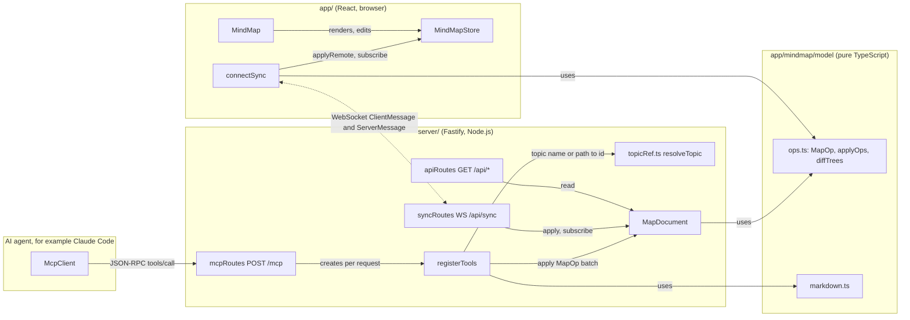
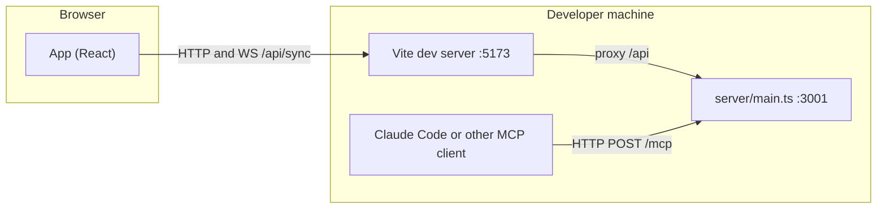
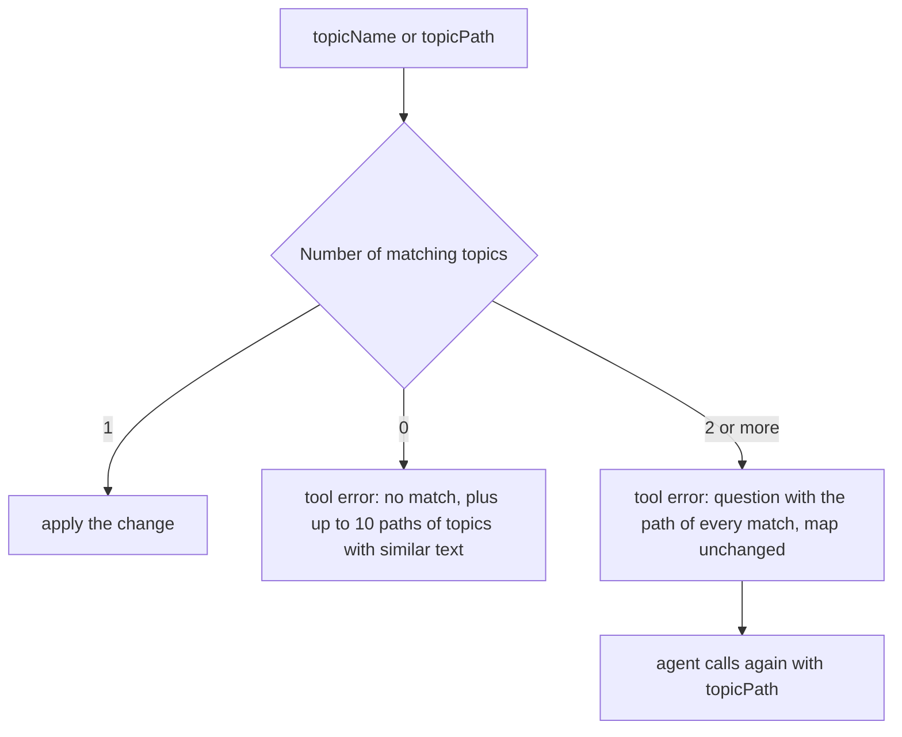
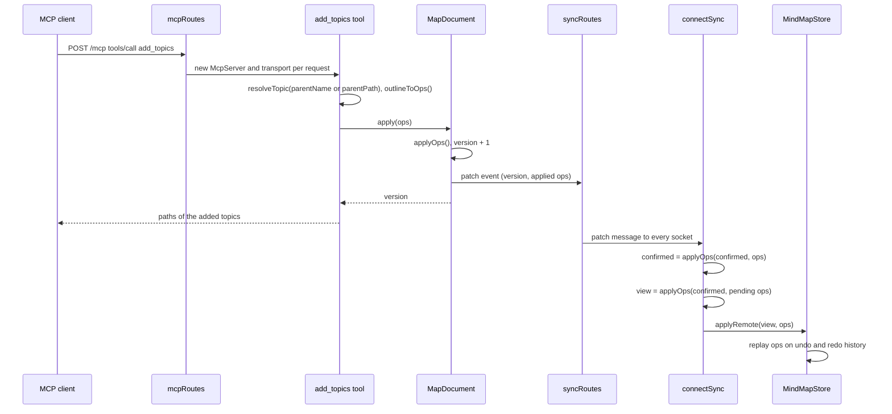
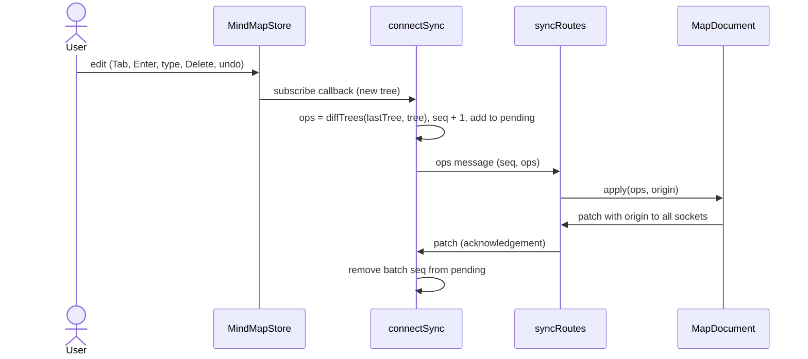
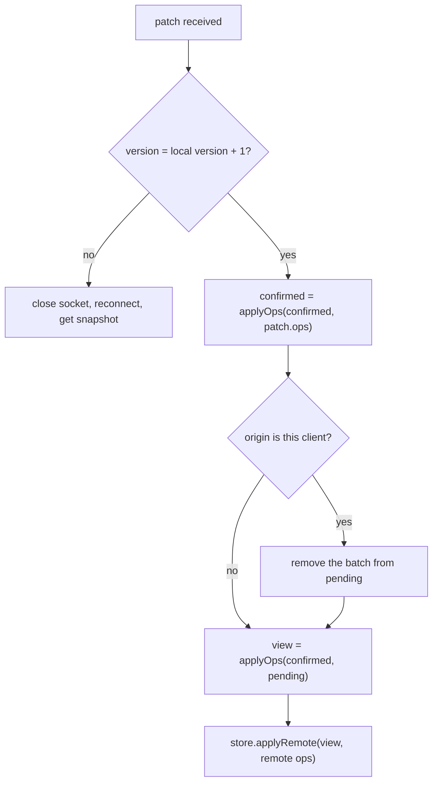
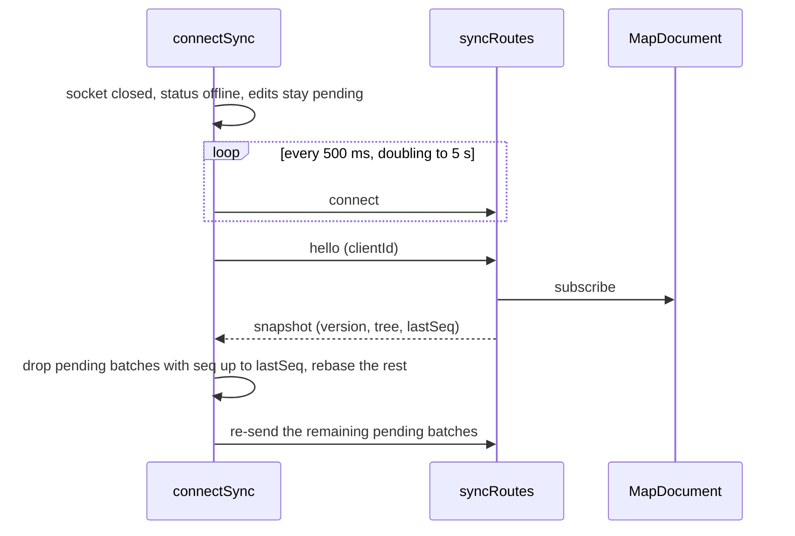

# MCP Server and Live Sync

## Summary

The server lets AI agents read and change the mind map that the user has open. The app shows each agent change at once, without a reload.

User edits in the app reach the server at once, so agents always work on the current map.

- The server holds exactly one map: the map the user has open. Tools have no map argument.
- Agents name topics by their text (`topicName`) or by their path (`topicPath`). Agents never see topic ids.
- Agents connect to `POST /mcp` (MCP Streamable HTTP). The app connects to the WebSocket `/api/sync`.
- Project persistence (Markdown files) is out of scope for this phase.

> Context: this is the MVP phase "MCP and ability for the app to push and update the state if agent changes it" of [mindmap-spec.md](mindmap-spec.md). The TypeScript server is a test bed for the tools and the sync protocol. A Tauri (Rust) back end can replace it later. That back end MUST implement the same MCP tools and the protocol in [protocol.ts](../app/mindmap/sync/protocol.ts).

## System View

The app, the server and the tools share one operation format (`MapOp`) and one pure tree model.



```
app/mindmap/
  model/        tree.ts, ops.ts (MapOp, applyOps, diffTrees, outlineToOps), markdown.ts - shared with the server
  store/        Zustand store; applyRemote() shows remote changes
  sync/         protocol.ts (WebSocket messages), syncClient.ts (connectSync)
app/App.tsx     connects the store to the server unless ?sample or ?offline is set
server/
  main.ts       entry point (PORT, HOST, LOG_LEVEL)
  app.ts        buildServer(): one MapDocument, registers the route plugins below
  map/          MapDocument (the open map, version, change events), zod schemas
  mcp/          tools.ts (all MCP tools), topicRef.ts (name and path resolution), routing.ts (POST /mcp)
  sync/         routing.ts (WebSocket /api/sync)
  api/          routing.ts (GET /api/health, /api/map)
e2e/live-sync.spec.ts   browser test: an MCP call appears in the open app
```

- The server imports only `app/mindmap/model/*` and `app/mindmap/sync/protocol.ts` from the app. The rule `server-only-to-app-model-and-protocol` in [.dependency-cruiser.cjs](../.dependency-cruiser.cjs) enforces this.
- The app never imports server code (rule `app-not-to-server`).

> Rationale: one model implementation for both sides makes `applyOps` give the same result in the app and on the server. That is the base of the sync. A separate `shared/` package was rejected for the MVP because the user asked for `app/` and `server/`, and the Rust back end will replace the server copy anyway.

## Deployment Diagram

Development runs two processes. Vite proxies `/api` (HTTP and WebSocket) to the server, so the app uses one origin.



| Command                | Starts                                                |
| ---------------------- | ----------------------------------------------------- |
| `npm run server`       | Server with reload on change (`tsx watch`), port 3001 |
| `npm run server:start` | Server without reload                                 |
| `npm run dev:all`      | Server and Vite together                              |
| `npm run test:e2e`     | Server on port 3012 and Vite on 5174, then Playwright |

- The project file [.mcp.json](../.mcp.json) registers the server for Claude Code as `thinking-patterns` (`http://localhost:3001/mcp`).
- Other clients: `claude mcp add --transport http thinking-patterns http://localhost:3001/mcp`.
- The server listens on `127.0.0.1` by default and has no authentication.

## Technology Stack

| Component                   | Version | Use                                          |
| --------------------------- | ------- | -------------------------------------------- |
| `fastify`                   | 5.x     | HTTP server                                  |
| `@fastify/websocket`        | 11.x    | WebSocket endpoint `/api/sync` (uses `ws`)   |
| `@modelcontextprotocol/sdk` | 1.x     | `McpServer`, `StreamableHTTPServerTransport` |
| `zod`                       | 4.x     | Tool input schemas, sync message validation  |
| `tsx`                       | 4.x     | Runs the TypeScript server without a build   |

> Rationale: Fastify was requested by the user. The MCP SDK transport takes Node `IncomingMessage` and `ServerResponse`, so Fastify passes `req.raw` and `reply.raw` after `reply.hijack()`. No adapter package is necessary.

## Topic References

Tools identify a topic by its text or by its path. [topicRef.ts](../server/mcp/topicRef.ts) resolves the reference to the internal topic id.

| Argument    | Type       | Matches                                                                               |
| ----------- | ---------- | ------------------------------------------------------------------------------------- |
| `topicName` | `string`   | The one topic with this text                                                          |
| `topicPath` | `string[]` | The topic whose ancestor texts end with this list, for example `["Product", "Risks"]` |

- Text comparison ignores case and repeated whitespace.
- The full path from the central topic always identifies one topic, unless two siblings have the same text. A shorter trailing part of the path also works while it is unique.
- `topicPath` has priority over `topicName` when a call gives both.
- Tools that reference a second topic use the same pair with another prefix: `parentName`/`parentPath` (`add_topics`) and `newParentName`/`newParentPath` (`move_topic`).
- Tools that reference several topics take `topics: [{topicName?, topicPath?}]`.

The tool resolves every reference before it changes the map.



An ambiguity question has this form:

```
topicName "Risks" is not unique: 2 topics have this text. Which one do you mean? Nothing was changed. Call again with "topicPath" set to one of:
- ["Plan","Product","Risks"]
- ["Plan","Marketing","Risks"]
```

- The question is a tool result with `isError: true`, so the agent cannot mistake it for a success.
- Each path is a JSON array that the agent can copy into `topicPath` as is.
- A tool with several references (`delete_topics`, `group_topics`) reports all unclear references in one message, numbered `Topic 1`, `Topic 2`.
- `add_topics` returns `notUniqueNames` when a new topic text also exists elsewhere. The agent then knows that it must use a path for these topics.

> Rationale: the user decided that agents work with names and paths, because an agent thinks in topic texts and the user talks about topics by text. Ids would force the agent to read the whole map first. An unclear name never falls back to "the first match", because a wrong guess changes the wrong part of the map. The question with all paths lets the agent choose, or ask the user, in one step.

## MCP Tools

All tools work on the open map. Every result is JSON text.

Topics in results are paths (`string[]`) or nested `{text, collapsed?, children?}` objects, never ids.

### Read tools

| Tool | Arguments | Result |
| --- | --- | --- |
| `get_topic` | `topicName` or `topicPath` | `path`, and the topic with all its subtopics |
| `search_topics` | `query`, `regex?`, `limit?` (default 50) | `total`, and `matches` as paths |
| `get_selection` | - | Path and subtopics of the topic selected in the app, or `null` |

### Change tools

| Tool | Arguments | Effect |
| --- | --- | --- |
| `add_topics` | `parentName`/`parentPath`?, `topics` or `markdown`, `index?` | Adds nested topics in one change. Default parent: the central topic. Unfolds the parent. |
| `update_topic` | `topicName`/`topicPath`, `text?`, `collapsed?` | Changes text, folds or unfolds. |
| `move_topic` | `topicName`/`topicPath`, `newParentName`/`newParentPath`, `index?` | Moves a subtree or reorders siblings. Refuses a move under its own subtree. |
| `delete_topics` | `topics[]` | Deletes subtrees. Refuses the central topic. |
| `group_topics` | `topics[]` (same parent), `text` | Adds a parent topic in place of the first topic and moves the topics under it. |
| `replace_map` | `title?`, `topics` or `markdown` | Replaces all topics. |
| `focus_topic` | `topicName`/`topicPath` | Unfolds the ancestors, then the open apps select the topic and scroll to it. |

- `topics` is a nested array: `[{text, collapsed?, children?: [...]}]`.
- `markdown` is a list: one `- Topic` per line, 2 spaces of indentation per level ([markdown.ts](../app/mindmap/model/markdown.ts)).
- In `replace_map`, a Markdown list with one top-level item is the whole map. That item is the central topic.
- Each change tool call is one atomic batch: one version step and one push to the apps.
- Tool annotations: read tools are `readOnlyHint`; `delete_topics` and `replace_map` are `destructiveHint`.

> Rationale: the tool set follows XMind MCP servers (search nodes, extract a subtree, build a map from structured topics) and adds live editing tools. The server has no `list_maps`, `create_map` or `get_map`: the user decided that the agent works only on the one map that the user has open. `get_topic` on the central topic returns the whole map when an agent needs it. Agents produce nested structure well, so `add_topics` takes a whole subtree or a Markdown list in one call. That gives fewer round trips and one atomic push per agent step. `get_selection` and `focus_topic` let the user point at "this topic" and let the agent show its result.

> Rationale: the agent cannot undo its changes through a tool, and the user cannot undo agent changes with ⌘Z. Undo is per author (see Behavior). An agent reverts its change with the inverse tool call.

## Sync Protocol

The WebSocket `/api/sync` carries JSON messages. The types are in [protocol.ts](../app/mindmap/sync/protocol.ts).

The sync uses topic ids internally; the MCP tools translate names and paths to ids.

| Direction | Message | Fields | Purpose |
| --- | --- | --- | --- |
| App to server | `hello` | `clientId` | Opens the connection |
| App to server | `ops` | `seq`, `ops: MapOp[]` | One batch of local edits |
| App to server | `selection` | `topicId` | The selected topic, for `get_selection` |
| Server to app | `snapshot` | `version`, `tree`, `lastSeq` | Full state after `hello`. `lastSeq` = last applied batch of this client. |
| Server to app | `patch` | `version`, `ops`, `origin?` | One applied batch. `origin` = `{clientId, seq}` for app batches. |
| Server to app | `focus` | `topicId` | Select and show a topic |
| Server to app | `error` | `message` | Invalid message or failed batch |

### Operations

`MapOp` ([ops.ts](../app/mindmap/model/ops.ts)) is the unit of change for the app, the server and the tools.

| Op             | Fields                            | Skipped when                                          |
| -------------- | --------------------------------- | ----------------------------------------------------- |
| `add`          | `id`, `parentId`, `index`, `text` | The id exists, or the parent does not exist           |
| `remove`       | `id`                              | The topic does not exist, or it is the root           |
| `move`         | `id`, `parentId`, `index`         | A topic is missing, the topic is the root, or a cycle |
| `setText`      | `id`, `text`                      | The topic does not exist, or the text is equal        |
| `setCollapsed` | `id`, `collapsed`                 | The topic does not exist, or the flag is equal        |

- `index` is the position among the siblings after the op. The value is clamped to the valid range.
- `applyOps` skips an op that does not fit and reports which ops took effect.
- `diffTrees(from, to)` computes ops that turn `from` into `to`. A randomized test in [ops.test.ts](../app/mindmap/model/ops.test.ts) checks this round trip.

> Rationale: lenient ops make the sync conflict-free in the MVP. A client re-applies its unconfirmed ops on top of the newest server state. An op whose topic someone deleted has no effect instead of an error. OT or CRDT libraries (Yjs, Automerge) were rejected for the MVP: the map is a small tree with few concurrent writers, and a CRDT would also have to exist in the Rust back end later.

## Behavior

### An agent change reaches the open app



- `MapDocument` emits the patch synchronously inside `apply()`. Every subscribed socket receives the patches in version order.
- `applyRemote` does not add an undo step. It applies the remote ops to every tree in the undo and redo history. The user's ⌘Z then reverts only the user's own edits and keeps the agent's changes.
- `applyRemote` moves the selection to a visible topic and closes the editor if its topic was removed.

### A user edit reaches the server



- The store applies the edit at once (optimistic). The app does not wait for the server.
- The server always broadcasts an app batch, also when no op took effect. The echo is the acknowledgement.
- The server ignores a batch with a `seq` that is not above the last applied `seq` of that client. A re-sent batch is applied only once.

### Concurrent changes converge

`connectSync` keeps the last confirmed server tree and the list of unconfirmed batches. The screen always shows `applyOps(confirmed, pending)`.



- The server applies batches in arrival order. All apps apply the same patches in the same order, so all apps reach the server tree when no batch is pending.
- An edit on a topic that another author deleted has no effect. The last write wins for text of the same topic.

### The app reconnects



- The `clientId` stays the same for the lifetime of the page, so `lastSeq` identifies the batches the server already applied.
- On the first snapshot the server tree replaces the local tree and clears the undo history.

### App modes

| URL               | Mode                                                 |
| ----------------- | ---------------------------------------------------- |
| `/`               | Syncs with the server                                |
| `/?sample=<name>` | Offline demo, in memory                              |
| `/?offline`       | Offline, in memory. The e2e GUI tests use this mode. |

- A badge in the top-right corner shows `Live`, `Connecting…` or `Offline`.
- Without a server the app works offline and retries the connection in the background.
- Several browser tabs show the same map and stay in sync.

## Data Model

| Model or type | Purpose | Defined in |
| --- | --- | --- |
| `MindMapTree` | Normalized tree: `rootId`, `nodes` by id | [types.ts](../app/mindmap/model/types.ts) |
| `MapOp` | One change; the sync unit | [ops.ts](../app/mindmap/model/ops.ts) |
| `ClientMessage`, `ServerMessage` | WebSocket messages | [protocol.ts](../app/mindmap/sync/protocol.ts) |
| `MapDocument` | The open map: `tree`, `version`, `lastSeq`, `selection` | [mapDocument.ts](../server/map/mapDocument.ts) |
| `TopicRef`, `AmbiguousTopicError` | Topic reference by name or path; the ambiguity question | [topicRef.ts](../server/mcp/topicRef.ts) |
| `TopicTree` | A topic with subtopics as tools return it | [tools.ts](../server/mcp/tools.ts) |
| `mapOpSchema`, `topicInputSchema`, `clientMessageSchema` | Runtime validation (zod) | [schemas.ts](../server/map/schemas.ts) |

## Verification

| Test | Covers |
| --- | --- |
| [ops.test.ts](../app/mindmap/model/ops.test.ts) | Each op, skip rules, `diffTrees` round trip over 300 random edit sequences |
| [markdown.test.ts](../app/mindmap/model/markdown.test.ts) | Markdown list output and parsing |
| [mindmapStore.test.ts](../app/mindmap/store/mindmapStore.test.ts) | `applyRemote`: no undo step, history replay, selection and editor repair |
| [mapDocument.test.ts](../server/map/__tests__/mapDocument.test.ts) | Versions, acknowledgements, duplicate batches |
| [topicRef.test.ts](../server/mcp/__tests__/topicRef.test.ts) | Name and path resolution, the ambiguity question, similar-topic hints |
| [tools.test.ts](../server/mcp/__tests__/tools.test.ts) | Every tool through an in-memory MCP client; no tool exposes an id |
| [sync.test.ts](../server/sync/__tests__/sync.test.ts) | Real server: MCP over HTTP pushes to the store; two apps and an agent converge; reconnect |
| [live-sync.spec.ts](../e2e/live-sync.spec.ts) | Browser: an MCP call appears on screen; `focus_topic` selects; a user edit reaches MCP |

## Limitations

- **No persistence:** the map exists only while the server runs. A restart resets it to an empty central topic, and the open app then shows the empty map.
- **One map:** all apps that connect to the server show the same map.
- **Same-text siblings:** two siblings with the same text have the same path. No reference can tell them apart; the agent gets the ambiguity question every time. The agent can rename one through the user, or delete both.
- **No authentication:** any local process can call `/mcp` and `/api/sync`. The server binds to `127.0.0.1` for this reason.
- **Last write wins:** concurrent text changes of one topic by two authors do not merge.
- **Stateless MCP:** `GET /mcp` and `DELETE /mcp` answer 405. The server sends no MCP notifications to agents.

## Future Improvements

- Persist the map as a Markdown list in a project file. `outlineToMarkdown` and `markdownToOutlines` are the base. The server then holds the map of the opened project file.
- A sibling index in `topicPath` (for example `"Risks#2"`) to tell same-text siblings apart.
- Topic notes, labels, markers and relationships (XMind features), with tools for them.
- An agent activity indicator in the app (which topics an agent changed last).
- Replace the Node server with the Tauri Rust core, with the same tools and protocol.
