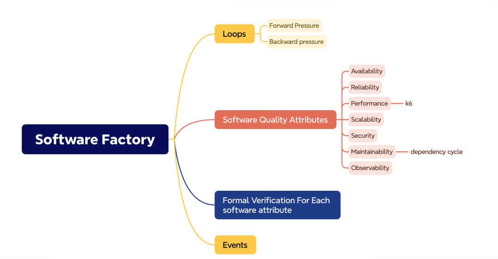
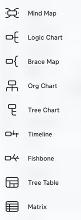

# MindMap MVP

In the very first iteration we will create mindmap app where I can create MindApp. All the state is not persisted anywhere.

## Technology Stack

### Stack

 - React
 - React Flow
 - Automatic positioning and alignment: ELK.js
 - Zustand

### Testing

- [ ] Storybook uses play unit tests
- [ ] Playwright tests only stand-alone app
- [ ] Jest unit tests for utilities and functions

## Features

- [ ] Autoalignment
- [ ] Standard mindmap node management features
- [ ] Good shortcuts: with Tab I can create sub node, with enter I can create sibling node (get inspiration from XMind)

## Next Phases After MVP

- [ ] MCP and ability for the app to push and update the state if agent changes it
- [ ] Tauri App for macOS
- [ ] mindmap is persisted and loaded from Markdown, that means all mindmap structure will be hierarchical and described as lists.
- [ ] Future iOS support